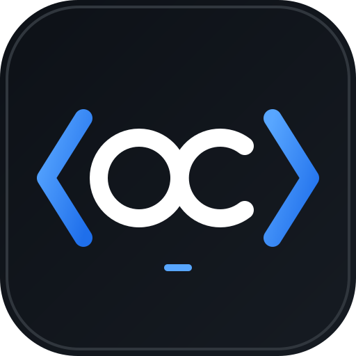

<div align="center">




<a href="https://github.com/otaype-wq"></a>

<a href="mailto:otaype@cip.org.pe"></a>


</div>

---

### 👨‍💻 Sobre mí

```javascript
const omar = {
  rol: "Software Developer",
  ubicacion: "Lima, Perú",
  organizacion: "Colegio de Ingenieros del Perú",
  enfoque: ["Código limpio", "Automatización", "Trabajo en equipo"],
  contacto: "otaype@cip.org.pe",
};
```

---

### 🛠️ Stack tecnológico

<div align="center">


</div>

---

### 📊 Estadísticas

<div align="center">


</div>

---

<div align="center">

### 📫 ¿Colaboramos?

**[otaype@cip.org.pe](mailto:otaype@cip.org.pe)**


</div>
